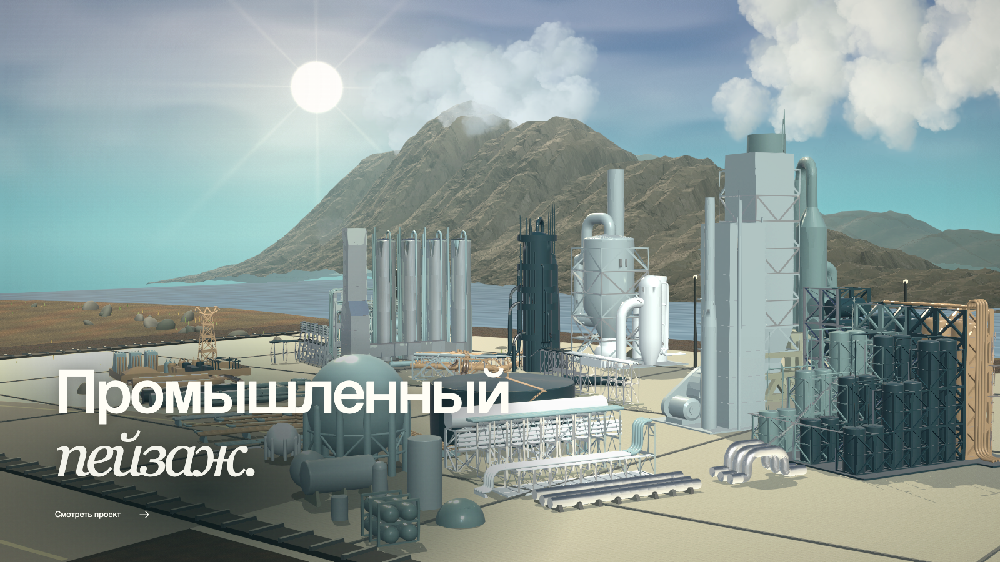
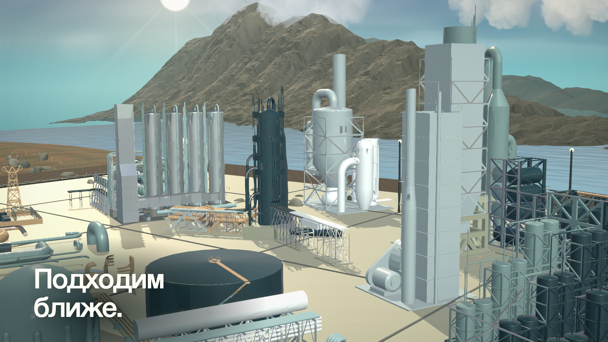
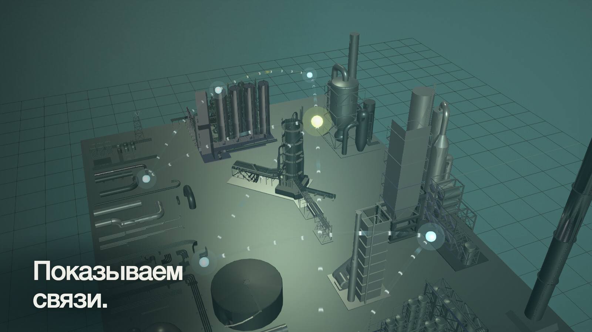

# AXIOM - Industrial Experience

Интерактивная 3D-презентация промышленного объекта в горном окружении. Прокрутка ведёт камеру от общего плана к оборудованию, внутрь трубопровода и к схеме связей.

Автор: [Марк / MDRK Studio](https://mdrkstudio.ru).

[Посмотреть кейс и видеопроход](https://mdrkstudio.ru/cases/axiom-industrial)



## Возможности

- Непрерывный маршрут камеры с восемью главами.
- Детализация оборудования, материалов и освещения.
- Проход внутри трубы, анимация механики и схема связей.
- Облака, горный ландшафт, HDR-освещение, тени и postprocessing.
- GLSL-материалы и анимированный поток.
- Управление прокруткой, свайпом и стрелками влево / вправо.
- Учёт `prefers-reduced-motion` при переходах между главами.

Это визуальная концепция для портфолио. Подключений к оборудованию, реальной телеметрии и промышленным системам в проекте нет.

## Стек

Next.js 15, React 19, TypeScript, React Three Fiber, Three.js, Drei, GSAP ScrollTrigger и React Three Postprocessing.

## Запуск

Нужны Node.js 22.12+ и npm.

```bash
npm ci
npm run dev
```

Открой `http://127.0.0.1:4273`. Нажми «Смотреть проект», используй прокрутку или стрелки влево / вправо. В финале кнопка «Посмотреть ещё раз» возвращает к началу.

## Сборка

```bash
npm run build
npm start
```

Сборка появляется в `.next`. Для другого порта можно передать `--port` в команду запуска. Секреты, переменные окружения и база данных не требуются.

## Структура

```text
app/                       Страница, метаданные и стили
components/AxiomExperience.tsx   Прокрутка, главы и подписи
components/IndustrialScene.tsx   3D-мир, материалы, анимация и камера
public/models/             Оптимизированная геометрия
public/textures/           Карты материалов и облаков
public/hdri/               HDR-окружение
public/draco/              Декодер геометрии
docs/                      Скриншоты проекта
```





## Графика и ресурсы

Для работы нужен браузер с WebGL 2 и аппаратным ускорением. Производительность зависит от GPU, экрана и устройства. Сцена содержит объёмную геометрию, тени и несколько эффектов; фиксированная частота кадров не гарантируется. Уменьшение движения не отключает 3D-рендеринг.

В публичной версии оставлены ресурсы действующей сцены. Офлайн-архивы моделей, инструменты Blender, референсы, варианты экспорта и рабочие отчёты не включены.

Источники геометрии, текстур и декодера описаны в [ASSETS.md](ASSETS.md). Модель Refinery Parts принадлежит Phil R. и сохраняет исходную лицензию 3D Warehouse. Текстуры ambientCG и Poly Haven распространяются по CC0, Draco - по Apache 2.0.

## Лицензия

Авторский код MDRK Studio распространяется по [PolyForm Noncommercial 1.0.0](LICENSE). Некоммерческое использование, изменения и распространение разрешены в пределах её условий. Сохраняйте текст лицензии и уведомление из [NOTICE](NOTICE).

Для коммерческого применения авторского кода нужно отдельное разрешение. [Связаться с MDRK Studio](https://mdrkstudio.ru/contacts).

Сторонние ресурсы сохраняют собственные лицензии и не перелицензируются в PolyForm. Это source-available проект с некоммерческой лицензией авторского кода.
